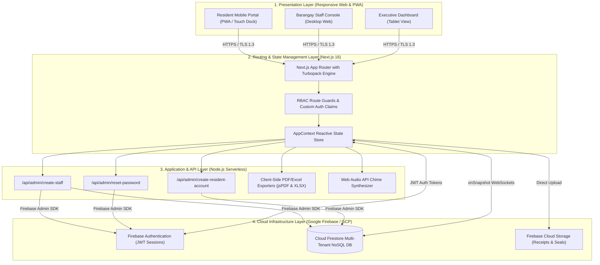

# iBarangay: Digital Barangay System

**A Project Proposal in System Integration Architecture 2**  
Presented to the Faculty of College of Computer Studies  
**Mindoro State University**  
Bongabong Campus, Oriental Mindoro  

In Partial Fulfillment of the Requirements for the Degree of  
**Bachelor of Science in Information Technology**  

**Proponents:**  
ALINDATO, LEONARD  
CLAUD, RYAN L.  
CORDERO, PRINCES KHEYSE T.  
MAGNAYE, ZEUS JARED  
SIENA, ANGEL ARRA L.  

**Submitted to:**  
**Nicko Magnaye**  
*System Integration Architecture*  
November 2026  

---

## INTRODUCTION

The shift toward digital governance has become a defining feature of public service delivery worldwide, and local government units are no exception. At the barangay level—the frontline of government closest to ordinary citizens—administrative work spans resident demographic recordkeeping, document clearance processing, revenue collection, dispute mediation under Katarungang Pambarangay, and regular reporting to higher municipal and national authorities. As community populations expand and civil transactions grow in frequency, so too do the administrative demands placed on barangay personnel. Technology can clean up the clutter of fragmented household documents, automate repetitive manual processing, provide round-the-clock accessibility outside of rigid physical office hours, eliminate revenue leakage, and deliver actionable data for executive decision-making.

Work on the digitization of the public sector reveals a clear trajectory: public agencies are modernizing back-office operations and foundational data management systems to directly empower frontline public services. A comprehensive review of public sector digitization efforts by Latupeirissa and collaborators (2024) considered the digital transformation of public institutions as a common pathway for modern governance, observing that digital technology adoption and workflow process redesigning are recognized levers for administrative performance. This transformation hinges on foundational factors such as governance capacity, institutional climate, workforce technological readiness, and cross-system data interoperability, which are consistently documented in literature as prerequisites for digital sustainability.

The same holds true within the Philippine local governance context. Under Republic Act No. 7160 (The Local Government Code of 1991), the barangay serves as the primary planning and implementing unit of government programs, projects, and services. A 2025 study on a local government unit in Baguio City demonstrated the transformative impact of digital data management by designing, developing, and deploying two interconnected digital systems (BREMS and BTRACK) to replace manual, paper-based records, resulting in significant gains in reliability, data accuracy, and administrative transparency (Nerona et al., 2025). Similarly, a 2025 study on Barangay San Miguel in Pasig City noted that while barangays are the primary entry point for citizen-state interaction, many remain burdened by manual, paper-based workflows for recordkeeping and document certification, which induce prolonged processing delays, clerical errors, and limited data availability for officials tasked with rapid civic decision-making (Enaño et al., 2025). Despite these documented benefits, however, many barangays across Oriental Mindoro—particularly within the Municipality of Bongabong—have yet to catch up with modern digital alternatives.

This operational gap was directly observed and affirmed by the Department of the Interior and Local Government (DILG) Bongabong, which reported witnessing persistent manual administrative practices across its constituent barangays: resident census information preserved in fragile, handwritten logbooks; certificates and clearances drafted, typed, and signed one at a time by hand; cash collections recorded in physical ledgers devoid of automated audit trails; and residents forced to make repeated, costly physical trips to the barangay hall merely to verify whether an applied clearance is ready for release. Crucially, on-site audits revealed a chronic structural disconnect between census demographic records and digital accounts: in pilot communities such as Barangay Mina de Oro, extensive census profiling yielded 52 verified resident records in local files, yet only two individuals possessed active digital portal accounts due to the absence of an integrated, automated provisioning bridge. All of these practices impede the efficient delivery of frontline services, introduce severe vulnerabilities to record loss from physical degradation or disasters, and exclude residents who cannot visit the barangay hall during limited weekday office hours.

As an direct response, and in formal coordination with the Local Government Unit (LGU) of Bongabong as the primary institutional partner of this study, the proposed solution to address these challenges is the **iBarangay System**, an automated, cloud-based Barangay Information Management, Demographic Profiling, and Civic Services Platform specifically engineered to digitize and unify barangay administration across the municipality. This system provides residents with convenient online registration, automated document requesting (Barangay Clearance, Certificate of Residency, Certificate of Indigency, and Business Permits) with dynamic tariff pricing and LGU seal attestation, secure digital payment reconciliation through GCash verification with transaction reference auditing, Katarungang Pambarangay incident blotter mediation tracking, a 24/7 local emergency responders directory (Duty Desk, MDRRMO, Police, Fire, RHU), and instant real-time civic notifications combining visual indicators with Web Audio API chime synthesis. Furthermore, the system produces dynamic analytics and executive reports for barangay officials and DILG Bongabong oversight. The system features a multi-tenant cloud architecture, granular role-based access control (RBAC), and server-side privileged credential management, ensuring scalability across barangays of varying population densities.

Since the system handles the personal, demographic, and financial transactions of Bongabong's citizens, data protection is not an auxiliary feature but a foundational architectural imperative. Republic Act No. 10173, or the Data Privacy Act of 2012, mandates that all entities collecting or processing the personal information of Filipino citizens must implement rigorous organizational, physical, and technical safeguards. iBarangay strictly enforces these principles through end-to-end TLS 1.3 transit encryption, tenant-isolated Firestore security rules (`barangayId` scoping), non-custodial administrative password resets, and automated audit logging.

---

## PURPOSE OF THE STUDY

The primary purpose of this study is to design, develop, deploy, and evaluate **iBarangay**, an automated, cloud-based Barangay Information Management, Demographic Profiling, and Civic Services Platform that modernizes the registration, processing, monitoring, and administration of resident records, document clearances, payment transactions, community blotter mediation, emergency dispatch, and executive reporting across the constituent barangays of the Local Government Unit (LGU) of Bongabong, Oriental Mindoro.

The study aims to address and resolve the systemic limitations inherent in manual, paper-reliant barangay operations by deploying a centralized, reactive cloud governance ecosystem. Specifically, the proposed system identifies the following core value propositions as its architectural pillars:
1. **Centralized Multi-Tenant Cloud Architecture:** Enforcing strict data segregation between individual barangays (`barangayId` scoping) while equipping municipal administrators and DILG Bongabong with consolidated oversight.
2. **End-to-End Automated Clearance Workflows:** Digitizing the entire clearance lifecycle—from citizen submission, dynamic fee calculation, and GCash transaction auditing to official stamped PDF certificate generation with dynamic municipal seals.
3. **Unified Demographic Census Registry:** Bridging the divide between physical household census records and digital portal accounts, enabling complete visibility of all community residents (such as the 52 verified records in Barangay Mina de Oro) alongside one-click administrative portal activation.
4. **Secure, Non-Custodial User Management:** Implementing granular Role-Based Access Control (RBAC) across five user roles (`Admin`, `Barangay Captain`, `Secretary`, `Treasurer`, `Resident`) paired with server-side Admin SDK endpoints that allow secure password resets without exposing plaintext credentials.
5. **Real-Time Reactive Notification Dispatch:** Coupling persistent visual indicators with Web Audio API chime synthesis to eliminate processing queue backlogs without client-side polling.
6. **Regulatory Compliance and Civic Safety:** Integrating Katarungang Pambarangay dispute tracking under Republic Act No. 7160, citizen data privacy protections under Republic Act No. 10173, and a localized 24/7 emergency responders hotline directory.

### Significance of the Study

The design, implementation, and deployment of iBarangay are expected to yield substantial operational, institutional, and socio-economic benefits across the following key areas:

1. **Centralized and Resilient Record Management.** The system replaces fragile paper logbooks, unencrypted desktop spreadsheets, and fragmented physical filing cabinets with an enterprise-grade Cloud Firestore NoSQL repository. This guarantees complete disaster resilience against physical record destruction (such as fire, floods, and natural wear), eliminates record misplacement, and establishes a unified demographic masterlist.
2. **Sub-Second Information Retrieval and High-Performance Auditing.** Authorized barangay personnel can search, filter, and paginate through hundreds of resident demographic profiles, pending clearance queues, and transaction histories within sub-second retrieval times through indexed multi-field queries (name, purok, household number, and case tracking IDs).
3. **Streamlined, Multi-Stage Clearance Processing.** The platform introduces a structured, transparent pipeline for civic certifications—encompassing Barangay Clearances, Certificates of Residency, Certificates of Indigency, and Business Permits. By automating fee determination, document formatting, and digital seal stamping, the system compresses clearance turnaround times from days to a matter of minutes.
4. **Substantial Reduction in Administrative Workload.** Repetitive, error-prone clerical tasks—such as re-typing resident details, manual tariff computations, and drafting individual certifications by hand—are fully automated. This frees Barangay Secretaries, Encoders, and Administrative Clerks to devote greater time to frontline public service and community welfare.
5. **Enhanced Information Accuracy and Data Integrity.** A structured schema enforced by client- and server-side validation rules (Zod schemas) guarantees data completeness upon submission. This eliminates clerical transcription errors, duplicate resident registrations, and inconsistent spelling across official municipal documents.
6. **Fraud-Resistant Financial Transparency and Auditable Revenue Tracking.** The system digitizes payment verification by requiring residents to submit official GCash transaction reference numbers alongside payment screenshot proofs. Barangay Treasurers are equipped with a side-by-side verification interface that automatically updates revenue ledgers, curbing revenue leakage and providing an auditable financial record for municipal audits.
7. **Statutory Information Security and Data Privacy Compliance.** Built in strict adherence to Republic Act No. 10173 (The Data Privacy Act of 2012), the platform enforces Role-Based Access Control (RBAC) and tenant-level security rules. Sensitive demographic and financial records are restricted strictly to authorized municipal roles, bolstered by encrypted TLS 1.3 transit, field-level access filtering, and non-custodial password resets.
8. **Expanded Citizen Accessibility and Financial Inclusivity.** Residents gain 24/7 mobile and desktop access to apply for certifications, submit payments, monitor application statuses in real time, and access emergency hotlines without needing to physically travel to the barangay hall, providing critical relief to senior citizens, persons with disabilities (PWDs), working parents, and citizens in remote puroks.
9. **Traceable Municipal Accountability and Executive Oversight.** The platform maintains automated, tamper-evident audit logs of every clearance approval, payment verification, and blotter docketing action. This organized historical record provides local leadership with verifiable accountability and arms DILG Bongabong with reliable municipal-wide data for social protection programs (e.g., TUPAD, 4Ps) and emergency disaster mitigation.
10. **Institutional Alignment with National E-Governance Initiatives.** The implementation of iBarangay accelerates the digital transformation of grassroots local government units across Oriental Mindoro, directly aligning the Municipality of Bongabong with the E-Governance framework of the Department of Information and Communications Technology (DICT) and the ease-of-doing-business standards mandated by Republic Act No. 11032.

---

## LITERATURE REVIEW

Around the globe, local governments are reinventing public service delivery through modernized information systems. Increasingly, local government units are applying their focus not only to the public-facing citizen interfaces, but also to the back-office recordkeeping, inter-departmental collaboration, and data-driven decision-making that occur behind the scenes each day.

This pattern is prominently evidenced in the review of 83 empirical publications on public sector digitization by Latupeirissa et al. (2024), conducted between 2018 and 2023. Their analysis demonstrated that successful public sector digital transformation is rarely driven by technology alone; rather, governance capacity, staff preparedness, organizational culture, and workflow redesign are co-equal determinants of success. Without sound institutional readiness and intuitive software design, digital interventions risk user abandonment.

These insights are mirrored in recent Philippine empirical studies at the grassroots barangay level:
* In Baguio City, Nerona and colleagues (2025) designed, field-tested, and deployed two interconnected information systems: BREMS (Barangay Resident Electronic Management System) for demographic census data and BTRACK for community project monitoring. Both systems were rated "excellent" by residents and technical reviewers, producing an immediate, measurable reduction in resident verification times and replacing deteriorating handwritten logbooks.
* In Pasig City, Enaño and colleagues (2025) developed *BarangayConnect* for Barangay San Miguel—a web-based resident records portal that automated document clearance requests, categorized educational attainment through data analytics, and provided local leaders with visual charts for resource allocation. Technical reviewers affirmed the platform’s high usability, dependability, and practical utility.
* In Oriental Mindoro and Region IV-B, Aliling (2025) documented that digital transformation in rural communities face distinct infrastructure obstacles, including intermittent electrical connectivity and variable mobile data bandwidth. The study underscored the necessity of deploying lightweight, mobile-responsive web platforms and Progressive Web Apps (PWAs) capable of caching assets locally and operating efficiently under constrained connectivity.

These cases establish an undeniable conclusion: iBarangay is not an isolated technological experiment; it represents an essential contribution to a nationwide movement modernizing local governance across the Philippines.

However, a digital system can only succeed if target stakeholders actively adopt and utilize it. As demonstrated by De Castro et al. (2026) in their investigation of local government digitalization in Mabalacat City, the success of e-transactional platforms depends fundamentally on the readiness of municipal personnel and citizen satisfaction. Even with an architecturally sound platform, successful adoption in the Municipality of Bongabong requires that barangay captains, secretaries, treasurers, and residents understand, trust, and easily navigate the software in their day-to-day civic responsibilities.

Evaluating this socio-technical dimension requires robust analytical models. The updated **DeLone and McLean (2003) Information Systems Success Model** evaluates system success across six interdependent dimensions: System Quality, Information Quality, Service Quality, System Use, User Satisfaction, and Net Benefits. In the context of iBarangay, technical functionality alone is insufficient; the platform must provide complete, accurate resident records that officials trust, while delivering a swift, responsive experience that satisfies citizen expectations. A meta-analysis of 53 empirical studies by Petter et al. (2013) validated that system success is driven by the synergistic linkages among these dimensions. For iBarangay to generate lasting net benefits for Bongabong, it must balance structural data integrity with user satisfaction.

Usability engineering becomes paramount when considering the wide variance in digital literacy among barangay end-users. iBarangay's stakeholders span elected officials, elderly community leaders, administrative clerks, and residents with minimal exposure to complex enterprise software. According to **ISO 9241-11:2018**, usability is defined as *"the extent to which a system can be used by specified users to achieve specified goals with effectiveness, efficiency, and satisfaction in a specified context of use."* Adhering to this standard dictates that iBarangay incorporate intuitive visual hierarchies, one-thumb mobile navigation docks, high-contrast semantic palettes, and accessible modal interactions that accommodate all literacy levels without sacrificing functionality.

### Synthesis

The reviewed literature and empirical findings demonstrate that digital transformation fundamentally enhances local government administration by establishing centralized data repositories, automating routine document certifications, mitigating financial errors, and empowering leaders with real-time analytics. Furthermore, Philippine studies establish that successful grassroots adoption requires systems specifically tailored to local statutory frameworks (RA 7160, RA 10173), resilient against bandwidth constraints via modern web frameworks, and designed with high usability standards. iBarangay synthesizes these theoretical and empirical foundations into an integrated, multi-tenant cloud application engineered to solve the administrative challenges of the Municipality of Bongabong.

---

## OBJECTIVES OF THE STUDY

### General Objective

The study aims to design, develop, deploy, and evaluate **iBarangay** as an automated, web-based Barangay Information Management System that modernizes and streamlines resident demographic profiling, document requests, digital payment transactions, dispute mediation, emergency dispatch, and administrative reporting across barangays in the Municipality of Bongabong, Oriental Mindoro.

### The study specifically aims to:

1. Identify and categorize the procedural bottlenecks, error rates, and security vulnerabilities present in current manual barangay operations across pilot communities in Bongabong.
2. Determine the functional, non-functional, usability, and statutory compliance requirements (RA 7160, RA 10173, RA 11032) for a multi-tenant cloud-based LGU management platform.
3. Design a secure, multi-tenant Cloud Firestore database schema that guarantees complete data isolation between constituent barangays via `barangayId` scoping.
4. Develop a centralized demographic census profiling module that captures household compositions, puroks, vulnerable sectors, and dynamically links physical census records to digital user accounts.
5. Develop an end-to-end automated document request workflow supporting Barangay Clearances, Certificates of Residency, Certificates of Indigency, and Business Permits with dynamic pricing and official PDF/Excel generation.
6. Develop a digital payment reconciliation module supporting GCash transaction proof uploads, reference number tracking, and automated revenue ledgers for the Barangay Treasurer.
7. Develop a robust user authentication and Role-Based Access Control (RBAC) mechanism supporting five roles (`Admin`, `Barangay Captain`, `Secretary`, `Treasurer`, `Resident`) with secure, non-custodial password resets.
8. Develop a real-time reactive notification engine combining visual badges, blinking indicators, and Web Audio API synthesized chimes for instant transaction alerts without polling.
9. Develop integrated community modules for Katarungang Pambarangay blotter dispute tracking, upcoming events broadcasting, and a 24/7 emergency responders hotline directory.
10. Evaluate the developed prototype's functional suitability, usability, performance efficiency, reliability, and security in accordance with the **ISO/IEC 25010** software quality standard and user acceptance testing across pilot barangay personnel and residents.

---

## RESEARCH QUESTIONS AND HYPOTHESES

### Research Question 1
What procedure can be followed to define a role-based access control and user management system that adequately protects sensitive citizen data across five distinct types of barangay users while remaining intuitive for officials with diverse degrees of digital literacy?
> **Hypothesis ($H_1$):** It is possible to engineer a granular role-based access control system utilizing Next.js route guards and server-side Firebase Admin SDK micro-routes (`/api/admin/create-staff`, `/api/admin/create-resident-account`, `/api/admin/reset-password`) that strictly isolates administrative functions while achieving an average task completion rate of over $90\%$ among frontline barangay staff.

### Research Question 2
What data architecture and processing workflow is the most complete, accurate, and efficient way of managing resident records and bridging physical census profiles with online portal accounts?
> **Hypothesis ($H_1$):** A unified data architecture that maps demographic census documents (`/residents/{id}`) directly to authentication identities (`/users/{uid}`) enables $100\%$ visibility of community residents (e.g., all 52 verified census records in Barangay Mina de Oro) and provides one-click account activation without manual re-entry.

### Research Question 3
Is the document clearance process totally automatable from online citizen application through payment verification to the generation of official stamped PDF certificates, while accommodating each barangay's unique pricing tariffs?
> **Hypothesis ($H_1$):** Decoupling document pricing into a configurable barangay document (`/barangays/{id}/documentPricing`) allows the system to automatically compute fees, verify eligibility, affix official LGU seals, and stream digitally verifiable PDF certificates in under 3 seconds per transaction.

### Research Question 4
What is the most convenient way for residents to transmit proof of payment to the barangay hall, and how can barangay treasurers verify transactions with greater accuracy and auditability?
> **Hypothesis ($H_1$):** A digital payment submission system that captures GCash transaction screenshots alongside required reference number fields reduces payment reconciliation time by over $70\%$ and eliminates bookkeeping arithmetic errors compared to manual physical cashbooks.

### Research Question 5
What is the recommended cloud architecture for a multi-tenant setup that guarantees complete data isolation between individual barangays while enabling municipal administrators and DILG to monitor overall operations?
> **Hypothesis ($H_1$):** Implementing a multi-tenant NoSQL collection architecture enforced by serverless Firestore Security Rules (`barangayId == request.auth.token.barangayId`) ensures complete cross-tenant isolation between barangays while allowing Super Administrators centralized oversight.

### Research Question 6
How do real-time reactive event listeners combined with synthesized audio chimes improve administrative turnaround time and notification awareness for barangay officials?
> **Hypothesis ($H_1$):** Synchronizing Cloud Firestore WebSocket listeners (`onSnapshot`) with Web Audio API multi-frequency chime synthesis alerts officials within $200\text{ ms}$ of citizen submissions, significantly decreasing pending clearance queue times without browser polling.

### Research Question 7
Can the system be effectively accessed and operated under low-bandwidth mobile environments through Progressive Web App (PWA) architecture and responsive mobile navigation?
> **Hypothesis ($H_1$):** Implementing a Workbox service-worker caching layer paired with a mobile-first bottom navigation dock (`MobileBottomNav`) ensures complete operational accessibility on mobile viewports ($\le 768\text{ px}$) even under intermittent rural connectivity.

### Research Question 8
How does the system enforce access controls, credential resets, and data retention to satisfy the statutory mandates of the Philippine Data Privacy Act of 2012 (RA 10173)?
> **Hypothesis ($H_1$):** Enforcing non-custodial administrative password resets, field-level data masking, TLS 1.3 encryption, and automated audit logging provides verifiable compliance with National Privacy Commission (NPC) regulatory requirements.

---

## PROPOSED METHODOLOGY

### Research Design

This study utilizes a **Developmental and Descriptive Research Design**:
* **Developmental Component:** Encompasses the software engineering, architectural modeling, database structuring, API development, and system integration of the iBarangay platform using Agile (Scrum) principles.
* **Descriptive Component:** Evaluates existing manual operational workflows, captures user requirements, and assesses the developed system’s quality, usability, and user acceptance using quantitative Likert-scale instruments based on ISO/IEC 25010 and the DeLone & McLean IS Success Model.

### Scope and Limitations

* **Geographical Scope:** This research is conducted within the **Municipality of Bongabong, Oriental Mindoro**, in institutional coordination with the Municipal Local Government Unit (LGU) and the Department of the Interior and Local Government (DILG) Bongabong.
* **Pilot Barangays:** Primary pilot deployment and empirical field testing focus on **Barangay Mina de Oro** as the lead pilot site, with comparative testing across selected neighboring communities (e.g., Labasan, Carmundo, Bagumbayani).
* **Limitations:** Digital payment processing is focused on GCash proof verification and over-the-counter cash receipting. Direct automated bank gateway integrations (e.g., Landbank API, PayMaya Enterprise) requiring commercial institutional merchant licensing are delimited to future phase expansions.

### Potential participants may include:
* Barangay Captains and Barangay Council Members (Punong Barangays / Kagawads)
* Barangay Secretaries
* Barangay Treasurers
* Barangay Administrative Staff, Clerks, and Encoders
* Municipal DILG Bongabong Officers and Technical Evaluators
* Residents of the designated pilot barangays across diverse age cohorts and puroks

### Development Approach:

The system is engineered using an **Agile (Scrum) Methodology** structured into ten (10) two-week sprints. The iterative Scrum framework facilitates continuous collaboration with DILG Bongabong, municipal officers, and pilot barangay staff, ensuring rapid delivery of working modules and frequent feedback loops prior to production deployment.

### System Architecture

The iBarangay platform is structured as an enterprise-grade, four-tier cloud architecture ensuring modularity, security, and real-time reactive data propagation:

```
┌────────────────────────────────────────────────────────────────────────┐
│                   iBarangay 4-Tier Cloud Architecture                  │
└────────────────────────────────────────────────────────────────────────┘
                                 │
     1. Client Presentation Tier │ HTTPS / TLS 1.3
     (Mobile PWA, Resident Portal, Staff Console, Captain Tablet)
                                 ▼
     2. Edge Routing & State Management Tier
     (Next.js App Router, Turbopack, RBAC Route Guard, AppContext)
                                 │
                 ┌───────────────┴───────────────┐
                 ▼                               ▼
     3. Serverless API Microservices    Client Real-Time Channel
     (/api/admin/create-staff           (useCollection / useDoc
      /api/admin/create-resident-account WebSockets onSnapshot)
      /api/admin/reset-password)                 │
                 │                               │
                 └───────────────┬───────────────┘
                                 ▼
     4. Google Cloud Firebase Infrastructure (GCP asia-southeast1)
     (Firebase Auth, Cloud Firestore NoSQL DB, Cloud Storage Buckets)
```



*Figure 1. Proposed System Architecture Overview and Cloud Integration Layout.*

#### Comprehensive System Modeling Blueprints (17 Diagrams Specification)
To guarantee complete architectural rigor, iBarangay is formally specified across **17 UML and SysML diagrams** (8 Structural Diagrams establishing the static blueprint, and 9 Behavioral Diagrams modeling dynamic runtime logic). Complete executable Mermaid models and external AI generation prompts are documented in [docs/system-modeling-and-17-diagrams.md](docs/system-modeling-and-17-diagrams.md):
1. **System Architecture Diagram:** Multi-tier edge routing, API micro-routes, and Firebase cloud services.
2. **Class Diagram:** Domain models (`Barangay`, `User`, `Resident`, `DocumentRequest`, `PaymentDetails`, `IncidentReport`, `BarangayEvent`, `EmergencyHotlines`).
3. **Component Diagram:** Modularity of UI viewports, `AppContext`, export utilities, and Firebase SDKs.
4. **Deployment Diagram:** Physical client devices, Docker/Node.js application containers, and GCP `asia-southeast1` multi-region instances.
5. **Object Diagram:** Concrete runtime snapshot of Barangay Mina de Oro data objects at execution timestamp.
6. **Package Diagram:** Layered codebase organization (`app/`, `components/`, `contexts/`, `firebase/`, `lib/`, `hooks/`).
7. **Composite Structure Diagram:** Internal ports and execution parts of the `DocumentProcessingEngine`.
8. **Profile Diagram:** Philippine LGU domain stereotypes (`<<LGU_Entity>>`, `<<Civic_Document>>`, `<<Blotter_Case>>`).
9. **Data Flow Diagram (DFD Level 1):** Six primary processing nodes connecting user inputs to cloud datastores.
10. **Use Case Diagram:** Functional boundaries across Resident, Secretary, Treasurer, Captain, and Admin actors.
11. **Activity Diagram:** Decision gates governing free vs. paid clearances, payment audits, and executive sign-off.
12. **Sequence Diagram:** Chronological event timeline featuring real-time WebSocket updates and audio chime dispatch.
13. **State Machine Diagram:** Formal lifecycle states of civic requests (`Pending` $\to$ `Approved` $\to$ `Payment_Verified` $\to$ `Released`).
14. **Communication Diagram:** Network collaboration hierarchy and numbered method call sequences.
15. **Interaction Overview Diagram:** High-level activity gates orchestrating nested sequence frames.
16. **Timing Diagram:** Explicit state waveforms mapped against municipal SLA targets ($t_0$ to $t_4$) and latency constraints ($<200\text{ ms}$).
17. **Requirement Diagram (SysML):** Traceability matrix mapping REQ-01 through REQ-06 to concrete software components.

### Core Technology Stack

| Component | Technology | Version / Specification | Technical Role in iBarangay |
|---|---|---|---|
| **Web Frontend** | Next.js with React | Next.js 16.1.6, React 19.x | UI rendering, Turbopack compilation, App Router layout, and PWA capabilities. |
| **Styling & Components** | Tailwind CSS & Radix UI | Tailwind v3.4, Radix Primitives | High-contrast civic UI theme, accessible modals, and responsive layout docks. |
| **Authentication** | Firebase Authentication | Identity Platform (OIDC / JWT) | Secure session tokens, password security, and role-based custom claims. |
| **Database** | Cloud Firestore | Managed NoSQL Document DB | Real-time multi-tenant data storage, reactive WebSocket streaming, and tenant-scoped indexing. |
| **Server-Side API SDK** | Firebase Admin SDK | `firebase-admin` v12.x | Elevated Node.js micro-routes for user creation, resident activation, and password resets. |
| **File Storage** | Firebase Cloud Storage | Google Cloud Storage | Secure multipart upload of GCash payment screenshots and official barangay seal graphics. |
| **Document Generation** | jsPDF & SheetJS (`xlsx`) | jsPDF v2.5, AutoTable, XLSX | Client-side streaming of official stamped PDF clearances and demographic Excel ledgers. |
| **Audio Notification** | HTML5 Web Audio API | Native Browser Synthesis | Synthesizes an audible double-beep chime ($880\text{ Hz} \to 1320\text{ Hz}$) on live transaction alerts. |
| **Table Pagination** | Custom `usePagination` Hook | Zero-dependency TypeScript | Consistent client-side pagination, page-size selection (10/25/50), and multi-field search. |
| **AI Engine** | Google Gemini 1.5 via Genkit | Genkit AI Next SDK | Natural-language query translation for executive demographic analytics and narrative reporting. |
| **Hosting & Edge CDN** | Vercel Platform | Global Edge Network | CI/CD automation, serverless function hosting, and low-latency edge caching. |
| **PWA Layer** | `@ducanh2912/next-pwa` | Workbox Service Worker | Local caching of static assets and mobile home-screen installability. |

### Methods of Data Gathering

The researchers will utilize four primary data-gathering methodologies:

1. **Interviews:** The proponents conduct semi-structured interviews with Punong Barangays, Barangay Secretaries, Treasurers, Encoders, and DILG Bongabong personnel to identify procedural bottlenecks, manual error frequencies, and specific municipal reporting requirements.
2. **Surveys:** Standardized survey questionnaires based on the DeLone & McLean IS Success Model and ISO/IEC 25010 criteria are administered to measure user satisfaction, perceived system quality, and operational impact.
3. **Observation:** Time-and-motion observation sessions track the step-by-step physical processing of clearances, blotter entries, and cash collections at the Barangay Hall to establish quantitative baseline benchmarks.
4. **Document Review:** Official records, historical clearance logbooks, Katarungang Pambarangay summons forms, and DILG reporting templates are examined to ensure exact alignment with statutory standards.

*Ethical & Data Privacy Safeguard:* In strict compliance with Republic Act No. 10173, all research data gathering excludes sensitive personally identifiable information, utilizing anonymized tokens and informed consent protocols approved by LGU Bongabong.

### System Development Process

The system is developed through an iterative Software Development Life Cycle (SDLC):

* **Phase 1 — Requirements Analysis:** Determine user needs across five administrative roles, map manual bottlenecks, formulate functional and non-functional specifications, and evaluate statutory compliance parameters.
* **Phase 2 — System Design:** Architect the multi-tenant Cloud Firestore database schema, configure RBAC permission matrices, design responsive UI layouts (including the mobile bottom navigation dock and resident carousel), and model the 17 UML/SysML system diagrams.
* **Phase 3 — Development:** Construct the application using Agile Scrum sprints: building the Next.js frontend, Firestore data hooks, serverless Admin SDK API endpoints (`create-staff`, `create-resident-account`, `reset-password`), Web Audio chime notification engine, and client-side PDF/Excel export engines.
* **Phase 4 — Testing:** Execute multi-tier testing: unit testing, integration testing, authentication security audits, Firestore Security Rules validation, cross-browser compatibility checks, and mobile responsiveness audits (0 TypeScript compilation errors maintained).
* **Phase 5 — Evaluation:** Conduct formal User Acceptance Testing (UAT) and ISO/IEC 25010 software quality evaluation with target barangay officials, administrative staff, DILG monitors, and community residents.

---

## PROPOSED RESEARCH TIMELINE

| Activities | Aug | Sep | Oct | Nov | Dec | Output Deliverable |
|---|:---:|:---:|:---:|:---:|:---:|---|
| **Phase 1 — Plan** | | | | | | |
| Topic selection & approval | ✓ | | | | | Approved Title & Scope |
| Preliminary literature review | ✓ | ✓ | | | | Literature Synthesis |
| Research problem & questions formulation | ✓ | | | | | Chapter 1 Problem Matrix |
| Concept paper / proposal preparation | ✓ | ✓ | | | | Proposal Manuscript |
| Stakeholder workshops (LGU & DILG Bongabong) | ✓ | ✓ | | | | Stakeholder Needs Notes |
| On-site audits of pilot barangays | | ✓ | | | | Baseline Operational Audit |
| **Phase 2 — Design** | | | | | | |
| System assessment & architecture design | | ✓ | ✓ | | | 4-Tier Cloud Architecture |
| Database design & RBAC matrix | | ✓ | ✓ | | | Firestore Schema & Security Rules |
| Complete 17 UML/SysML system modeling diagrams | | ✓ | ✓ | | | 17 System Diagrams Specification |
| Interface design & mobile responsive layouts | | | ✓ | | | Figma & Component Library |
| **Phase 3 — Develop** | | | | | | |
| Sprints 1–4: Auth, RBAC, Profiling & Census Engine | | | ✓ | ✓ | | Core Resident Engine |
| Sprints 5–7: Document Queue, GCash & Report Engine | | | | ✓ | | Clearance & Payment Workflow |
| Sprints 8–10: Events, Audio Alerts & PWA Dock | | | | ✓ | | Complete Production Prototype |
| **Phase 4 — Test** | | | | | | |
| Unit, integration & system testing | | | | ✓ | | 0 TypeScript Errors; Rules Deployed |
| Security testing & data privacy audit | | | | ✓ | | Security Audit Compliance Report |
| **Phase 5 — Feedback** | | | | | | |
| User acceptance testing (pilot staff & residents) | | | | ✓ | | Empirical UAT Survey Datasets |
| ISO/IEC 25010 Quality Model evaluation | | | | ✓ | | Statistical Evaluation Findings |
| **Phase 6 — Implementation** | | | | | | |
| Data analysis & statistical interpretation | | | | ✓ | | Research Findings Chapter |
| Research documentation & final manuscript binding | ✓ | ✓ | ✓ | ✓ | ✓ | Comprehensive Project Book |
| Final revision | | | | ✓ | ✓ | Revisions Incorporated |
| Final oral presentation / defense | | | | | ✓ | Institutional Project Approval |

---

## REFERENCES

Aliling, J. T. (2025). Digitalizing governance: A transformation on the processes of one community in the Philippines. *International Journal of Multidisciplinary Research and Analysis*, 8(6), 3168–3176. https://doi.org/10.47191/ijmra/v8-i6-68

De Castro, E. C., Estiller, R. C., Estiller, J. R., & Jimenez, J. R. (2026). Digitalization of local government unit: Towards a more responsive service delivery policy of Mabalacat City [Conference paper]. *The Asian Conference on the Social Sciences 2026, Official Conference Proceedings*. International Academic Forum.

DeLone, W. H., & McLean, E. R. (2003). The DeLone and McLean model of information systems success: A ten-year update. *Journal of Management Information Systems*, 19(4), 9–30. https://doi.org/10.1080/07421222.2003.11045748

Department of the Interior and Local Government. (2019). *The Katarungang Pambarangay handbook*. Local Government Academy, DILG.

Enaño, J. V., Natividad, K. P., Pantoja, D. R., Ebi, F. C. D., Bautista, J. V., & Cura, D. (2025). BarangayConnect: A web-based information portal for resident data, administrative services, and community records using data analytics and linear regression algorithms. *International Journal of Research and Innovation in Social Science*, 9(10), 1485–1497. https://doi.org/10.47772/IJRISS.2025.910000127

International Organization for Standardization. (2018). *Ergonomics of human-system interaction — Part 11: Usability: Definitions and concepts* (ISO Standard No. 9241-11:2018). https://www.iso.org/standard/63500.html

International Organization for Standardization. (2011). *Systems and software engineering — Systems and software Quality Requirements and Evaluation (SQuaRE) — System and software quality models* (ISO/IEC Standard No. 25010:2011). https://www.iso.org/standard/35733.html

Latupeirissa, J. J. P., Dewi, N. L. Y., Prayana, I. K. R., Srikandi, M. B., Ramadiansyah, S. A., & Pramana, I. B. G. A. Y. (2024). Transforming public service delivery: A comprehensive review of digitization initiatives. *Sustainability*, 16(7), Article 2818. https://doi.org/10.3390/su16072818

Nerona, G. G., Ortiz, S. J. G., Quizon, L. K. A., Racuya, J. K. I., Abata, P. J. O., Corpuz, J. K. B., Flores, C. N. B., Luna, S. M., Matchoc, H. L. P., & Modesto, N. D. (2025). Improving the data management system of a local government unit in Baguio City, Philippines through information systems solutions: Towards enhanced sustainable public service. *Journal of Intelligent Systems and Applied Data Science*, 3(2), 72–84. https://doi.org/10.64680/jisads.v3i2.46

Petter, S., DeLone, W., & McLean, E. R. (2013). Information systems success: The quest for the independent variables. *Journal of Management Information Systems*, 29(4), 7–62. https://doi.org/10.2753/MIS0742-1222290401

Republic of the Philippines. (1991). *Republic Act No. 7160: An act providing for a Local Government Code of 1991*. Official Gazette of the Republic of the Philippines.

Republic of the Philippines. (2012). *Republic Act No. 10173: An act protecting individual personal information in information and communications systems in the government and the private sector, creating for this purpose a National Privacy Commission, and for other purposes (Data Privacy Act of 2012)*. Official Gazette of the Republic of the Philippines.

Republic of the Philippines. (2018). *Republic Act No. 11032: An act promoting ease of doing business and efficient delivery of government service amending for the purpose Republic Act No. 9485, otherwise known as the Anti-Red Tape Act of 2007, and for other purposes*. Official Gazette of the Republic of the Philippines.
