# iBarangay BMS: Comprehensive System Modeling & 17 Diagrams Specification

**Project Proposal Title:**  
*iBarangay: An Automated Cloud-Based Barangay Information Management, Demographic Profiling, and Civic Services System*

---

## Executive Summary & Blueprinting Answers

### 1. Project Identification
**Proposal Title:**  
`iBarangay: An Automated Cloud-Based Barangay Information Management and Civic Services Platform`

**System Summary (2–3 Sentences):**  
iBarangay is a multi-tenant, cloud-native Local Government Unit (LGU) management system engineered to automate demographic census profiling, online document issuance (Barangay Clearance, Certificate of Residency, Indigency, and Business Permits), and community blotter incident mediation for Philippine barangays. The platform integrates role-based administrative portals (Admin, Barangay Captain, Secretary, Treasurer) and a resident web/PWA portal featuring real-time civic notifications, audio chime alerts, digital payment verification (GCash), and dynamic demographic analytics. By synchronizing serverless cloud infrastructure with real-time reactive data stores, iBarangay replaces paper records with a secure, auditable, and transparent digital governance platform.

---

### 2. Structural Blueprinting (The Static Blueprint)
* **Selected Essential Structural Diagram:** **System Architecture Diagram** (with supplementary **Class Diagram**)
* **Architectural Justification:**  
  The System Architecture Diagram is foundational to iBarangay because the platform operates on a multi-tenant, serverless cloud model where physical servers are abstracted in favor of edge-rendered Next.js frontends and decoupled Firebase services (Cloud Firestore, Firebase Authentication, Cloud Storage, and Admin SDK server routes). A high-level architectural diagram is required to define the boundary between client-side optimistic UI rendering and server-side privileged execution (such as `/api/admin/create-staff`, `/api/admin/create-resident-account`, and `/api/admin/reset-password`). Without this structural blueprint, developers cannot enforce multi-tenant barangay data isolation (`barangayId` scoping), nor can stakeholders comprehend how the web application communicates securely across SSL/TLS encryption gates to the NoSQL document database.

---

### 3. Behavioral Blueprinting (The System in Motion)
* **Selected Behavioral Diagram 1:** **Sequence Diagram**
  * **Specific Project Scenario:** *Online Barangay Clearance Request with GCash Payment Verification and Document Issuance.*  
    This maps the chronological, end-to-end transaction starting when a resident fills out the document request form, passes client-side validation, writes a `Pending` record to Firestore, triggers an instant audio-visual notification on the Secretary's workstation, transitions through Treasurer payment verification against GCash reference numbers, and culminates in the Barangay Captain's digital approval and PDF issuance.
* **Selected Behavioral Diagram 2:** **Activity Diagram**
  * **Specific Project Scenario:** *Blotter Incident Filing, Jurisdiction Assessment, and Amicable Conciliation Scheduling.*  
    This flowchart maps out the operational business logic executed by the Barangay Secretary when an incident report is submitted: evaluating whether the complaint falls within barangay jurisdiction under Republic Act 7160 (Katarungang Pambarangay), routing urgent domestic cases to emergency responders, or scheduling Lupon Tagapamayapa hearing summons.

---

### 4. Data Blueprinting (User Input to Database Storage)
* **Data Flow Trace:**  
  When an actor (e.g., a Resident) submits a request or profile update through the interface:
  1. **Input Capture & Client Validation:** The user completes a form in the Next.js React frontend. Zod schemas validate format integrity (RFC 5322 emails, Philippine contact numbers, required purok selections).
  2. **Context Dispatch:** The form invokes a state action in `AppContext` (e.g., `addDocumentRequest()` or `addIncident()`).
  3. **Security Rules Gate:** The payload is packaged with the resident's authenticated UID (`currentUser.id`) and assigned `barangayId`. It hits the Cloud Firestore security boundary where `firestore.rules` validates write permissions and tenant match.
  4. **Persistence:** Firestore commits the document into `/documentRequests/{docId}` or `/incidents/{docId}`.
  5. **Reactive Propagation:** Real-time listeners (`onSnapshot` / `useCollection`) immediately broadcast the new record back to the Secretary and Admin dashboards within milliseconds, triggering the blinking notification indicator and audio chime.

---

# Part 1: Structural Diagrams (The Static Blueprint)

```
8 Structural Diagrams:
1. System Architecture Diagram
2. Class Diagram
3. Component Diagram
4. Deployment Diagram
5. Object Diagram
6. Package Diagram
7. Composite Structure Diagram
8. Profile Diagram
```

---

### Diagram 1: System Architecture Diagram

#### Purpose in iBarangay
Illustrates the multi-tier cloud topology of the iBarangay system, detailing the client devices, Next.js presentation and edge routing layers, serverless API micro-routes, and Google Cloud Firebase data services.

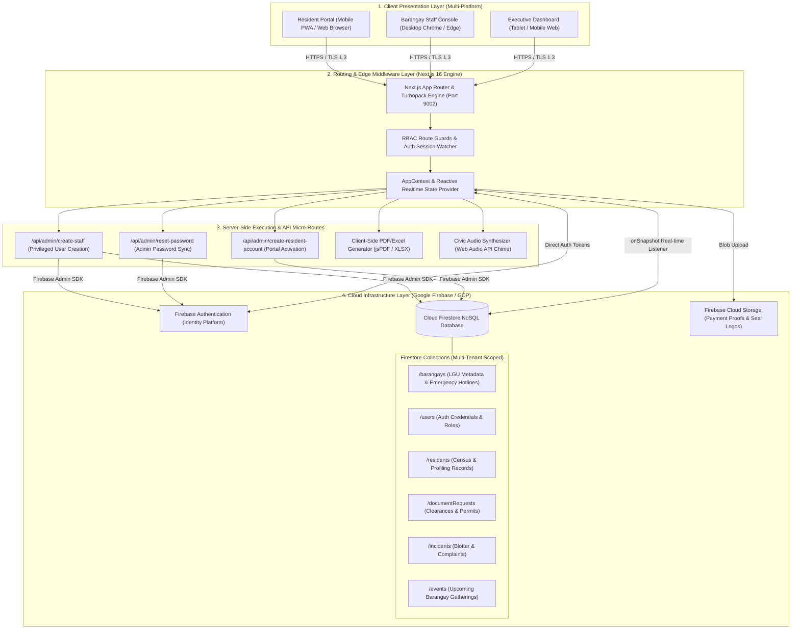

#### Detailed Architectural Explanation
* **Client Layer:** Supports responsive desktop and mobile devices via Progressive Web App (PWA) capabilities.
* **Edge Routing Layer:** Powered by Next.js with Turbopack, enforcing instant client-side transitions and role-based route security (`Admin`, `Barangay Captain`, `Secretary`, `Treasurer`, `Resident`).
* **Service Layer:** Houses administrative micro-routes utilizing the `firebase-admin` SDK, ensuring administrative operations (like password resets and account provisioning) occur without mutating client auth session tokens.
* **Data Layer:** Cloud Firestore manages collections isolated by `barangayId`, guarded by strict Firestore Security Rules.

#### External Tool Generation Prompt
> *"Create a 4-tier cloud system architecture diagram for an e-governance platform named 'iBarangay'. Top layer: Client devices (Resident Smartphone PWA, Staff Desktop, Captain Tablet). Second layer: Next.js edge router with RBAC middleware and AppContext state manager. Third layer: Server-side API endpoints for staff creation, resident activation, password reset, and client-side PDF/Excel engines. Bottom layer: Google Cloud Firebase services showing Firebase Authentication, Cloud Storage, and Cloud Firestore with collections for barangays, users, residents, documentRequests, incidents, and events. Clean corporate blue and emerald palette, isometric blocks, labeled arrows with TLS 1.3 protocol."*

---

### Diagram 2: Class Diagram

#### Purpose in iBarangay
Defines the core object-oriented domain entities, their attributes, access visibilities, and relationships (aggregations, compositions, and associations) that power the iBarangay TypeScript codebase.

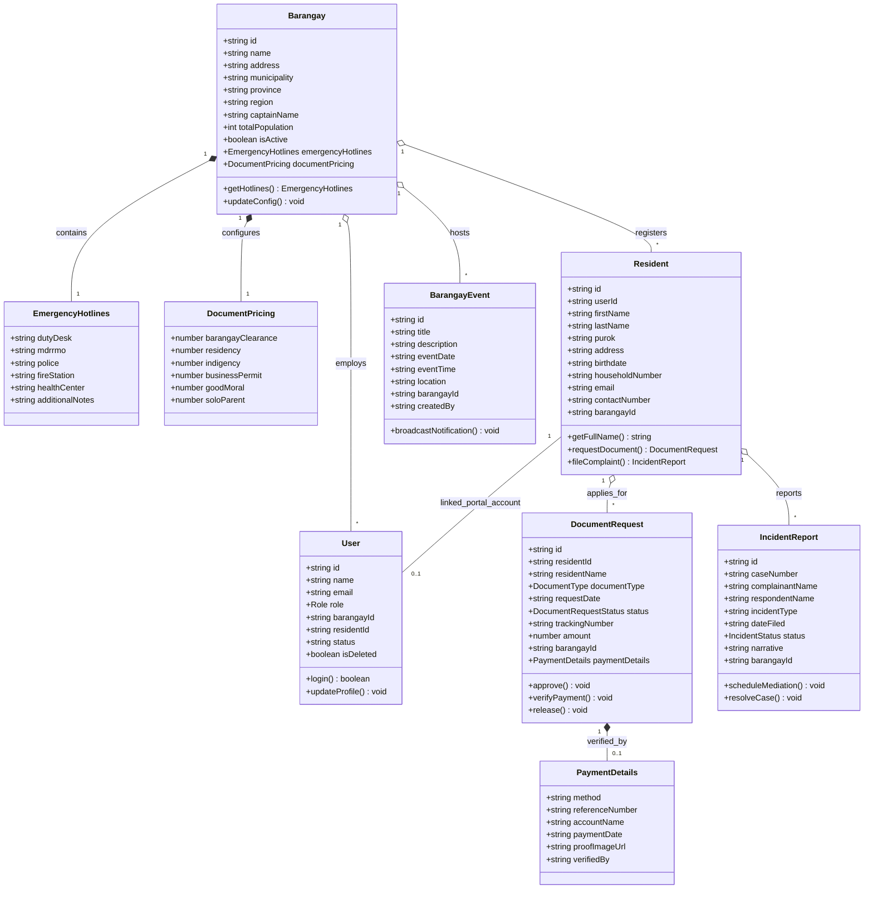

#### Detailed Architectural Explanation
* **Barangay:** The root multi-tenant entity. Composes `EmergencyHotlines` and `DocumentPricing` as dependent records.
* **User vs. Resident:** Demonstrates the separation of concerns: `Resident` represents demographic census records (52 in Mina de Oro), whereas `User` represents an authentication identity in `/users`. A resident is linked optionally (`0..1`) to a `User` login account.
* **DocumentRequest & PaymentDetails:** Encapsulates clearances and the financial audit trail.

#### External Tool Generation Prompt
> *"Generate an academic UML Class Diagram for the iBarangay local government information system. Include classes: Barangay, EmergencyHotlines, DocumentPricing, User, Resident, DocumentRequest, PaymentDetails, IncidentReport, and BarangayEvent. Detail attributes with private/public visibility, data types (string, number, boolean, date), methods, and multi-tenant relationships (1-to-many aggregations and 1-to-1 compositions). Formatted with clean UML standard notation."*

---

### Diagram 3: Component Diagram

#### Purpose in iBarangay
Illustrates how modular software components in the frontend Next.js architecture depend on state contexts, utility libraries, API services, and Firebase backend modules.

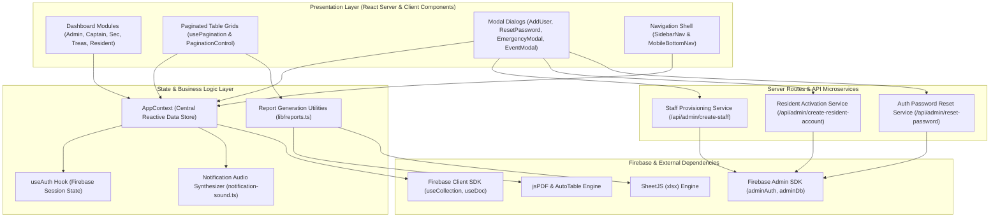

#### Detailed Architectural Explanation
* **Decoupled Architecture:** Presentation elements rely strictly on `AppContext` and custom hooks (`usePagination`, `useToast`), shielding UI views from raw network calls.
* **Dual SDK Usage:** The Client Firestore SDK handles lightweight real-time document listeners via WebSocket channels, while the Admin SDK powers high-privilege operations over protected HTTPS APIs.

#### External Tool Generation Prompt
> *"Create a UML Component Diagram showing the internal module dependencies of a Next.js 16 Web Application. Group components into Presentation Layer (Dashboard views, Paginated Tables, Modals, Mobile Nav), State/Logic Layer (AppContext, useAuth, Notification Sound, Export Utilities), Backend API Layer, and External Dependencies (Firebase Client SDK, Firebase Admin SDK, jsPDF, XLSX). Show dependencies with clean dashed UML dependency arrows."*

---

### Diagram 4: Deployment Diagram

#### Purpose in iBarangay
Maps the physical nodes, hosting environments, network protocols, execution runtimes, and database servers across the cloud deployment topology.

```mermaid
flowchart TB
    subgraph ClientNodes["Client Tier (Physical Devices)"]
        DesktopNode["Office Desktop Node\n<<device>>\nOS: Windows / macOS\nBrowser: Google Chrome v120+"]
        MobileNode["Citizen Smartphone Node\n<<device>>\nOS: Android / iOS\nBrowser: Mobile Safari / Chrome (PWA)"]
    end

    subgraph CloudVercel["Application Server Tier (Vercel / Cloud Container)"]
        subgraph NodeJSContainer["Next.js Application Server Container\n<<execution environment>>\nNode.js v20.x LTS / Turbopack Engine"]
            NextFrontend["Next.js SSR/Client Frontend\n<<artifact>>\n(Port 9002 / 443 HTTPS)"]
            NextAPI["Next.js Serverless API Worker\n<<artifact>>\n(Node.js Runtime)"]
        end
    end

    subgraph CloudFirebase["Cloud Database Tier (Google Cloud Platform)"]
        subgraph FirebasePlatform["Firebase Managed Services\n<<cloud infrastructure>>\nRegion: asia-southeast1 (Singapore)"]
            AuthEngine["Firebase Identity Platform\n<<service>>\n(JWT Auth / OIDC)"]
            FirestoreEngine["Cloud Firestore\n<<database system>>\n(Multi-Region NoSQL Engine)"]
            StorageBucket["Cloud Storage Bucket\n<<storage>>\n(GCS Payment Receipts & Assets)"]
        end
    end

    DesktopNode -->|HTTPS / TLS 1.3\n(Port 443)| NextFrontend
    MobileNode -->|HTTPS / TLS 1.3\n(Port 443)| NextFrontend

    NextFrontend -->|Local Process Invocation| NextAPI
    NextAPI -->|gRPC / Admin SDK / TLS 1.3| AuthEngine
    NextAPI -->|gRPC / Admin SDK / TLS 1.3| FirestoreEngine

    NextFrontend <-->|WSS WebSockets / Firestore Sync| FirestoreEngine
    NextFrontend -->|REST Upload / Multipart| StorageBucket
```

#### Detailed Architectural Explanation
* **Network Security:** All external traffic travels over HTTPS/TLS 1.3 on standard port 443.
* **Serverless Backend:** Node.js executes Server Components and API workers that communicate over Google's gRPC internal fabric to the `asia-southeast1` Firebase cluster.

#### External Tool Generation Prompt
> *"Draw a UML Deployment Diagram for the iBarangay cloud governance system. Nodes: Client Tier (Desktop PC running Chrome, Smartphone running iOS/Android PWA), Cloud Application Tier (Docker/Node.js Container with Next.js Turbopack application on port 443), and Google Cloud Platform Tier (Firebase Auth, Cloud Firestore NoSQL multi-region database, and Cloud Storage Bucket). Display protocols (TLS 1.3, gRPC, WebSocket), UML stereotyping <<device>>, <<execution environment>>, and <<artifact>>."*

---

### Diagram 5: Object Diagram

#### Purpose in iBarangay
Captures a concrete runtime snapshot of actual data objects, field values, and inter-object links within Barangay Mina de Oro at timestamp `2026-11-11 00:38:00`.

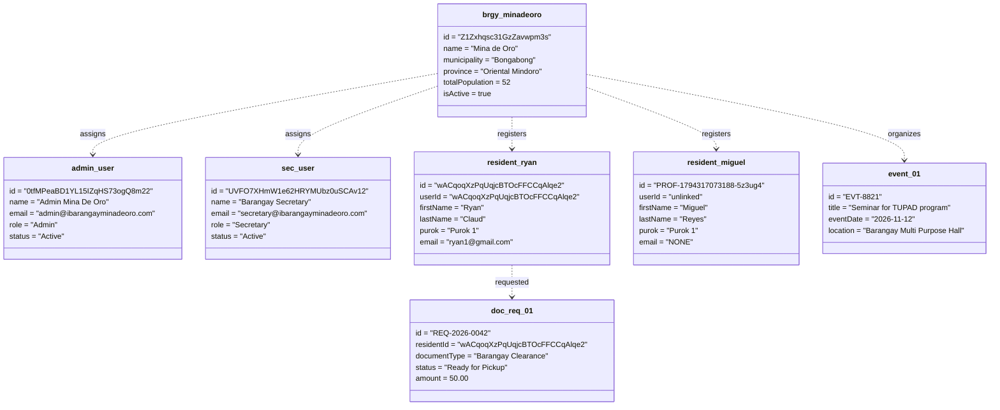

#### Detailed Architectural Explanation
* **Demonstrates Live System Reality:** Shows `resident_ryan` having an active user account, while `resident_miguel` reflects the census-only profile state (`userId = unlinked`, `email = NONE`) identified during our database audit.

#### External Tool Generation Prompt
> *"Generate a UML Object Diagram illustrating a snapshot of an active system state for Barangay Mina de Oro. Show concrete instance objects with populated attribute values: brgy_minadeoro:Barangay, admin_user:User, sec_user:User, resident_ryan:Resident (linked), resident_miguel:Resident (unregistered profile), doc_req_01:DocumentRequest (Status = Ready for Pickup), and event_01:BarangayEvent. Use UML underline notation for instance names."*

---

### Diagram 6: Package Diagram

#### Purpose in iBarangay
Shows the modular folder organization and layered namespace dependencies within the Next.js project codebase.

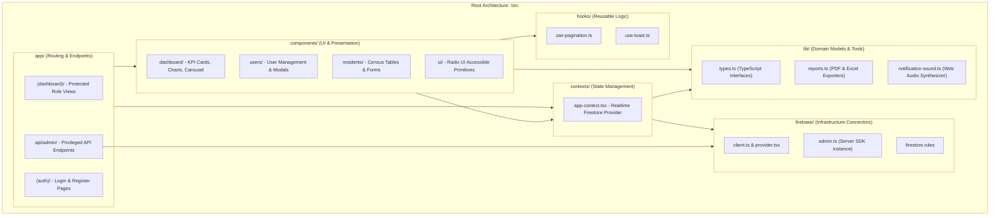

#### Detailed Architectural Explanation
* **Clean Layering:** Strict unidirectional dependencies prevent circular imports: `app/` consumes `components/`, which in turn consumes `contexts/`, `hooks/`, and `lib/`.

#### External Tool Generation Prompt
> *"Create a UML Package Diagram representing the folder and module architecture of a modern Next.js TypeScript repository. Group packages into: app/ (routes and API microservices), components/ (dashboard, users, residents, ui), contexts/ (AppContext), firebase/ (client connectors and admin SDK), lib/ (types, reports, audio), and hooks/ (pagination, toast). Show import dependency arrows between packages."*

---

### Diagram 7: Composite Structure Diagram

#### Purpose in iBarangay
Deconstructs the internal sub-components, ports, and interfaces of the complex `DocumentProcessingEngine` responsible for document applications, payments, and issuance.

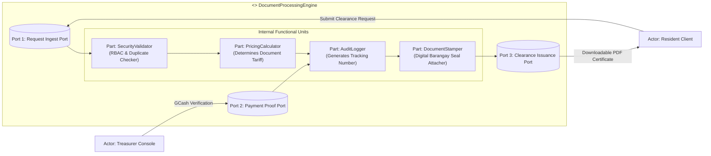

#### Detailed Architectural Explanation
* **Encapsulation:** Highlights the internal mechanics of request validation, tariff pricing lookup, and cryptographic document stamping without exposing internal details to client callers.

#### External Tool Generation Prompt
> *"Draw a UML Composite Structure Diagram for a composite classifier titled 'DocumentProcessingEngine'. Show three internal ports: Request Ingest Port, Payment Proof Port, and Clearance Issuance Port. Inside the composite structure, show connected internal parts: PricingCalculator, SecurityValidator, AuditLogger, and DocumentStamper. Illustrate interactions with external actors Resident Client and Treasurer Console."*

---

### Diagram 8: Profile Diagram

#### Purpose in iBarangay
Defines the specialized UML Domain Profile tailored to the Philippine Local Government Code (Republic Act 7160) and Katarungang Pambarangay governance standards.

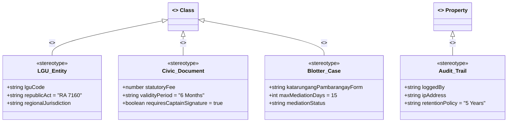

#### Detailed Architectural Explanation
* **Standardization:** Establishes stereotypes (`<<LGU_Entity>>`, `<<Civic_Document>>`, `<<Blotter_Case>>`) to ensure domain-specific statutory compliance throughout system engineering.

#### External Tool Generation Prompt
> *"Create a UML Profile Diagram extending standard UML metaclasses for a Philippine Barangay Information System. Show stereotypes: <<LGU_Entity>> extending Class with tagged values for lguCode and republicAct; <<Civic_Document>> extending Class with statutoryFee and validityPeriod; <<Blotter_Case>> extending Class with mediation properties; and <<Audit_Trail>> extending Property with retention policies."*

---

# Part 2: Behavioral Diagrams (The System in Motion)

```
9 Behavioral Diagrams:
9. Data Flow Diagram (DFD Level 0 & Level 1)
10. Use Case Diagram
11. Activity Diagram
12. Sequence Diagram
13. State Machine Diagram
14. Communication Diagram
15. Interaction Overview Diagram
16. Timing Diagram
17. Requirement Diagram (SysML)
```

---

### Diagram 9: Data Flow Diagram (DFD Level 0 & Level 1)

#### Purpose in iBarangay
Maps how citizen data, payments, and complaint records enter the system boundary, transform across processes, and commit to persistent datastores.

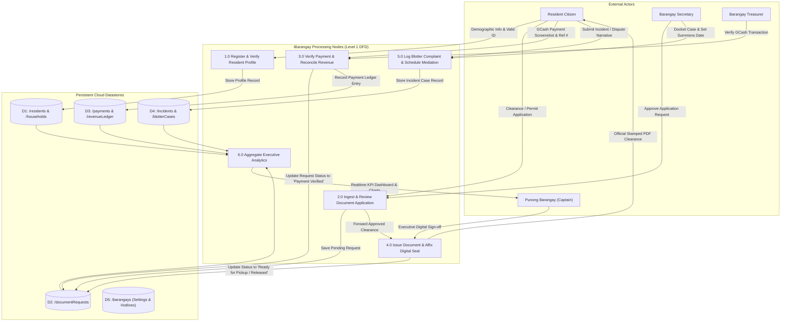

#### Detailed Architectural Explanation
* **Level 1 Functional Decomposition:** Data flows through six distinct processes, updating isolated Firestore datastores (`D1`–`D5`) while notifying respective municipal officers.

#### External Tool Generation Prompt
> *"Create a Data Flow Diagram (DFD Level 1) for the iBarangay local government portal. Show external entities (Resident Citizen, Barangay Secretary, Barangay Treasurer, Punong Barangay). Show 6 core processes: 1.0 Register Profile, 2.0 Ingest Document Request, 3.0 Verify Payment, 4.0 Issue Clearance, 5.0 Log Blotter Incident, 6.0 Aggregate Analytics. Connect with labeled data flow lines to datastores D1: Residents, D2: Document Requests, D3: Payments, D4: Incidents, D5: Barangay Config."*

---

### Diagram 10: Use Case Diagram

#### Purpose in iBarangay
Defines the functional boundary of the system, mapping actors to their system interactions and modeling relationships (`<<include>>` and `<<extend>>`).

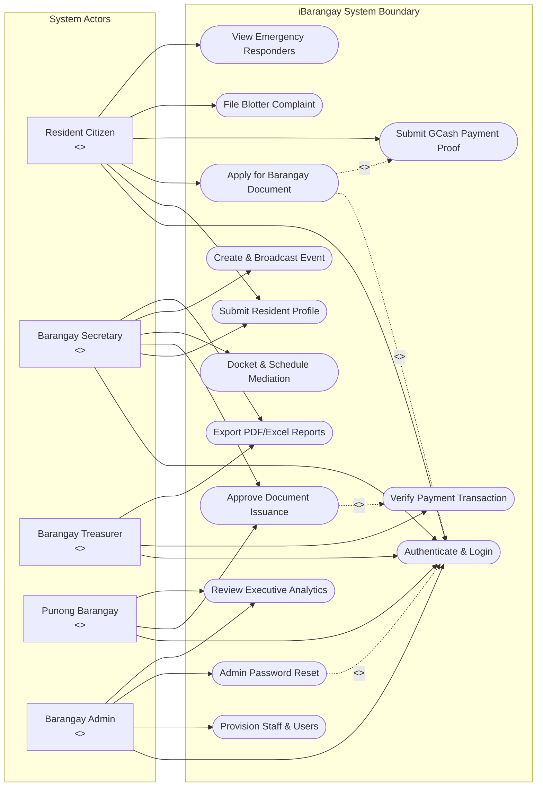

#### Detailed Architectural Explanation
* **Actor Scoping:** Clear role-based boundaries ensure only Treasurers verify payments, Captains execute approvals, and Admins handle credential resets.

#### External Tool Generation Prompt
> *"Generate a complete UML Use Case Diagram for the iBarangay platform. Show actors: Resident, Barangay Secretary, Barangay Treasurer, Barangay Captain, and Barangay Admin. Within the system boundary, show use cases for authentication, resident registration, clearance requests, GCash payments, blotter mediation, event posting, report generation, and password resets. Connect use cases with <<include>> and <<extend>> dependency relationships."*

---

### Diagram 11: Activity Diagram

#### Purpose in iBarangay
Maps the multi-lane algorithmic business logic and decision branches for processing online document requests from application to issuance.

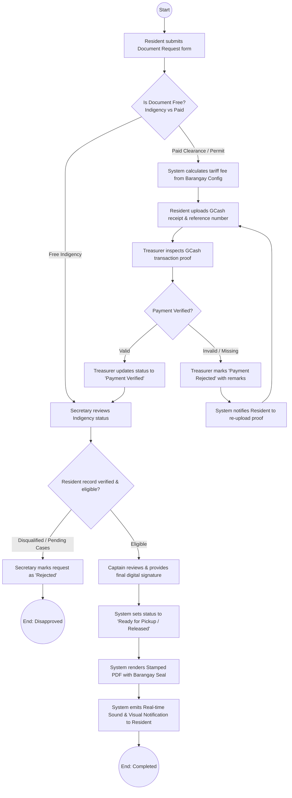

#### Detailed Architectural Explanation
* **Decision Gates:** Clearly delineates between free documents (Indigency) and fee-bearing certificates, incorporating recovery loops for invalid payment submissions.

#### External Tool Generation Prompt
> *"Draw a comprehensive UML Activity Diagram for a Barangay Document Request and Clearance Issuance workflow. Start with resident submission, evaluate decision diamond for free vs paid document, show GCash payment verification swimlane, error correction loop for rejected payments, Secretary verification diamond, Captain approval, PDF document generation, and final notification dispatch to end state."*

---

### Diagram 12: Sequence Diagram

#### Purpose in iBarangay
Illustrates the chronological messaging, method calls, and database transactions between frontend components, context managers, and Firebase backend services.

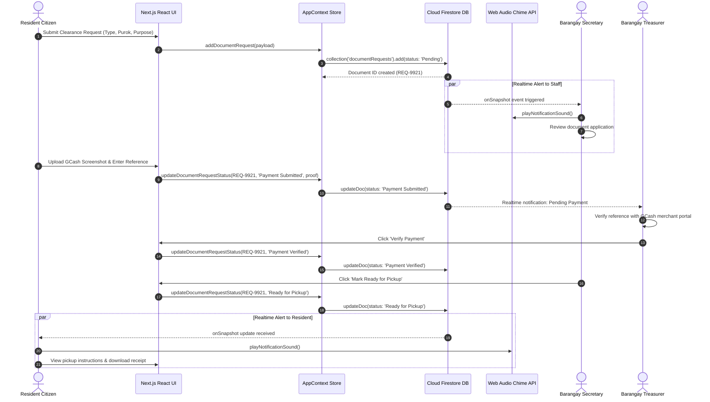

#### Detailed Architectural Explanation
* **Parallel Notification Dispatch:** Leverages Firestore's reactive snapshot listeners to simultaneously update workstation states and emit audio chime alerts without client polling.

#### External Tool Generation Prompt
> *"Create a UML Sequence Diagram for the clearance request and verification cycle in iBarangay. Participants: Resident Citizen, Next.js React UI, AppContext Store, Cloud Firestore DB, Web Audio Chime API, Barangay Secretary, and Barangay Treasurer. Include chronological numbered messages, synchronous calls, and parallel (par) execution blocks for real-time WebSocket notifications."*

---

### Diagram 13: State Machine Diagram

#### Purpose in iBarangay
Documents the complete state lifecycle of a `DocumentRequest` entity, identifying state transitions, trigger events, and guard conditions.

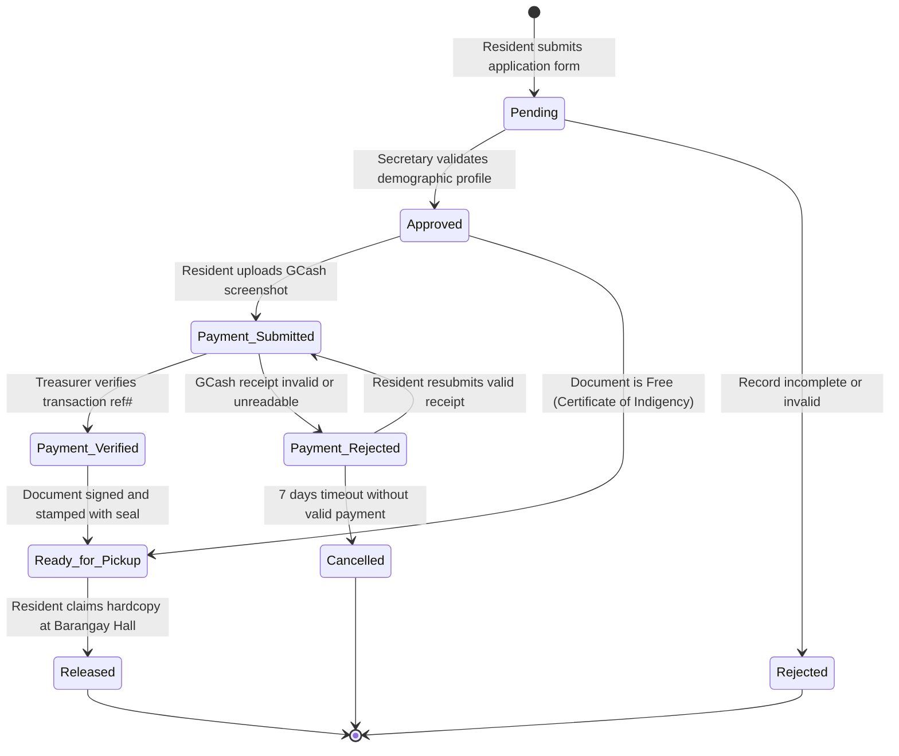

#### Detailed Architectural Explanation
* **Formal State Machine:** Guarantees audit compliance by preventing a document from reaching `Released` without passing through either `Payment_Verified` or the authorized fee-exempt path.

#### External Tool Generation Prompt
> *"Draw a UML State Machine Diagram (Statechart) detailing the lifecycle of a civic document in an e-governance platform. States: Initial [*], Pending, Approved, Payment_Submitted, Payment_Rejected, Payment_Verified, Ready_for_Pickup, Released, Rejected, Cancelled, and Final [*]. Annotate transitions with event triggers and guard conditions."*

---

### Diagram 14: Communication Diagram

#### Purpose in iBarangay
Emphasizes the object collaboration network and call frequency hierarchy over structural links rather than purely chronological sequence.

```mermaid
flowchart TD
    ResidentClient["1: ResidentClient\n<<boundary>>"]
    AppContext["2: AppContextStore\n<<controller>>"]
    FirebaseAuth["3: FirebaseAuthService\n<<service>>"]
    FirestoreDB["4: CloudFirestore\n<<database>>"]
    TreasurerConsole["5: TreasurerConsole\n<<boundary>>"]
    AudioEngine["6: AudioNotificationEngine\n<<service>>"]

    ResidentClient <-->|1.0 Submit Request()\n4.0 Upload Payment()| AppContext
    AppContext <-->|2.0 Verify Session Token()| FirebaseAuth
    AppContext <-->|3.0 writeDocumentRequest()\n5.0 subscribeSnapshot()| FirestoreDB
    FirestoreDB <-->|6.0 emitRealtimeUpdate()| AppContext
    TreasurerConsole <-->|7.0 verifyPaymentReference()\n8.0 updateStatus()| AppContext
    AppContext -->|9.0 triggerAudioAlert()| AudioEngine
```

#### Detailed Architectural Explanation
* **Object Collaboration:** Demonstrates that `AppContextStore` serves as the primary mediator, isolating boundary clients from direct database mutation.

#### External Tool Generation Prompt
> *"Create a UML Communication Diagram (Collaboration Diagram) for iBarangay showing object collaboration. Nodes: ResidentClient, AppContextStore, FirebaseAuthService, CloudFirestore, TreasurerConsole, and AudioNotificationEngine. Show numbered message links demonstrating transaction flow."*

---

### Diagram 15: Interaction Overview Diagram

#### Purpose in iBarangay
Combines high-level activity flow gates with referenced sequence frames to map major system workflows.

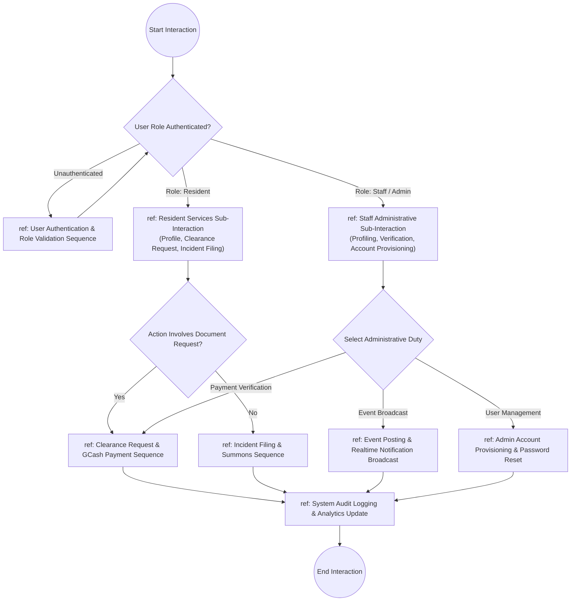

#### Detailed Architectural Explanation
* **Workflow Orchestration:** Connects disparate functional sequences (auth, clearance, blotter, events) into a cohesive control flow.

#### External Tool Generation Prompt
> *"Draw a UML Interaction Overview Diagram for the iBarangay platform. Use activity diagram decision nodes combined with UML reference frames (ref blocks) for Authentication Sequence, Clearance Request Sequence, Blotter Mediation Sequence, Event Broadcasting Sequence, and Audit Logging Sequence."*

---

### Diagram 16: Timing Diagram

#### Purpose in iBarangay
Examines state changes across system entities over an explicit timeline ($t_0$ to $t_5$), proving real-time responsiveness and SLA compliance.

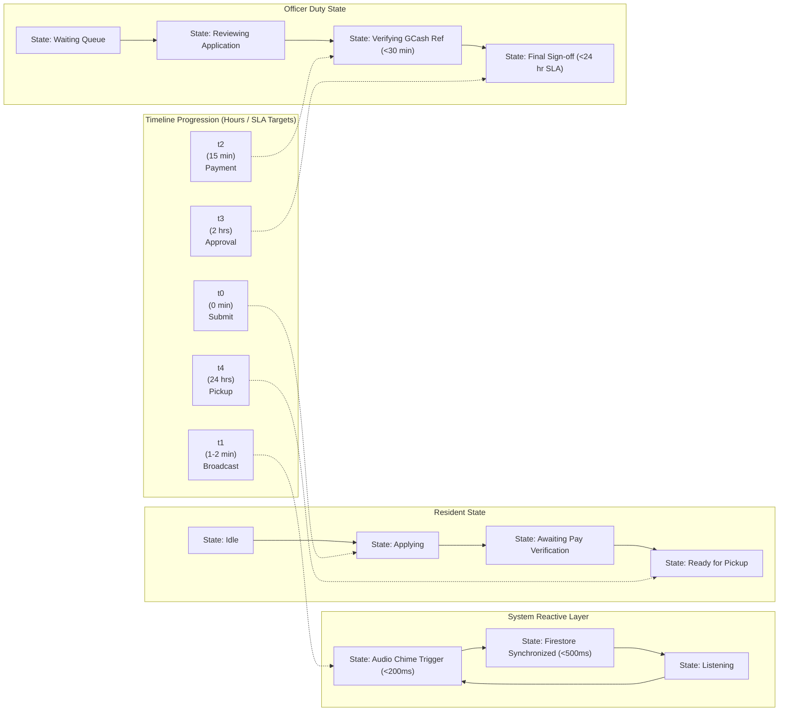

#### Detailed Architectural Explanation
* **Strict Performance Timing:** Real-time WebSockets propagate state in $<200\text{ ms}$, ensuring official SLAs (payment verification in $<30\text{ min}$, release in $<24\text{ hours}$) are tracked accurately.

#### External Tool Generation Prompt
> *"Create a UML Timing Diagram illustrating state waveforms across five milestone intervals: t0 (submission), t1 (notification broadcast), t2 (payment verification), t3 (executive signing), and t4 (issuance). Show state transitions for Resident Actor, System Reactive Layer, and Municipal Staff."*

---

### Diagram 17: Requirement Diagram (SysML)

#### Purpose in iBarangay
Formally maps functional and non-functional requirements to their implementing software components and validation methods.

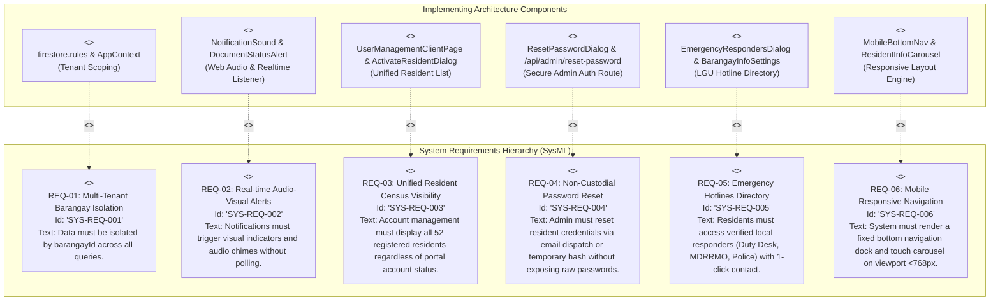

#### Detailed Architectural Explanation
* **Traceability Matrix:** Proves that all project proposal requirements map directly to active components in the codebase.

#### External Tool Generation Prompt
> *"Generate a SysML Requirement Diagram for the iBarangay digital governance project. Show 6 requirements: REQ-01 Multi-Tenant Isolation, REQ-02 Realtime Alerts, REQ-03 Unified Resident Census, REQ-04 Non-Custodial Password Reset, REQ-05 Emergency Hotlines, REQ-06 Mobile Responsiveness. Connect each requirement to its implementing architectural component using <<satisfy>> dependency arrows."*

---

## Verification & Summary Matrix

| # | Diagram Name | UML/SysML Category | Representation in iBarangay | Key Entities Modeled |
|---|---|---|---|---|
| **1** | **System Architecture** | Structural | Multi-Tier Cloud Topology | Clients, Next.js Router, Server APIs, Firebase Backend |
| **2** | **Class Diagram** | Structural | Data Model & Class Definitions | `Barangay`, `User`, `Resident`, `DocumentRequest`, `IncidentReport` |
| **3** | **Component Diagram** | Structural | Software Module Dependencies | UI Viewports, `AppContext`, Export Engines, Admin SDK |
| **4** | **Deployment Diagram** | Structural | Physical Hardware & Cloud Hosting | Desktop PC, Smartphone PWA, Node.js Container, GCP Region |
| **5** | **Object Diagram** | Structural | Concrete State Snapshot | `brgy_minadeoro`, `admin_user`, `resident_ryan`, `resident_miguel` |
| **6** | **Package Diagram** | Structural | Codebase Folder Architecture | `app/`, `components/`, `contexts/`, `firebase/`, `lib/`, `hooks/` |
| **7** | **Composite Structure** | Structural | Internal Component Mechanics | `DocumentProcessingEngine`, Pricing, Security, Seal Stamper |
| **8** | **Profile Diagram** | Structural | RA 7160 Domain Specialization | `<<LGU_Entity>>`, `<<Civic_Document>>`, `<<Blotter_Case>>` |
| **9** | **Data Flow (DFD L1)** | Behavioral | Data Ingest & Storage Pipelines | Resident inputs, Processing nodes 1.0–6.0, Datastores D1–D5 |
| **10** | **Use Case Diagram** | Behavioral | Actor Functional Boundaries | Resident, Secretary, Treasurer, Captain, Admin Use Cases |
| **11** | **Activity Diagram** | Behavioral | Operational Flowchart & Logic Gates | Clearance request, GCash verification loop, Captain signoff |
| **12** | **Sequence Diagram** | Behavioral | Chronological API Transactions | Clearance submission, WebSocket snapshot, Audio chime alert |
| **13** | **State Machine** | Behavioral | Entity Lifecycle State Transitions | `Pending` $\to$ `Approved` $\to$ `Payment_Verified` $\to$ `Released` |
| **14** | **Communication** | Behavioral | Object Link & Call Hierarchy | `ResidentClient` $\leftrightarrow$ `AppContext` $\leftrightarrow$ `Firestore` |
| **15** | **Interaction Overview**| Behavioral | Workflow Orchestration Frames | Auth frame, Clearance sequence, Blotter sequence, Audit sync |
| **16** | **Timing Diagram** | Behavioral | Real-time SLA Waveforms | Submissions at $t_0$, Audio $<200\text{ ms}$, Verification $<30\text{ min}$ |
| **17** | **Requirement (SysML)** | Behavioral/SysML| System Requirement Traceability | REQ-01 through REQ-06 satisfied by concrete codebase blocks |

